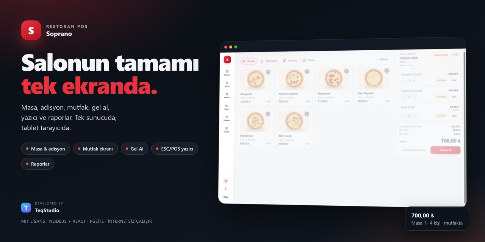
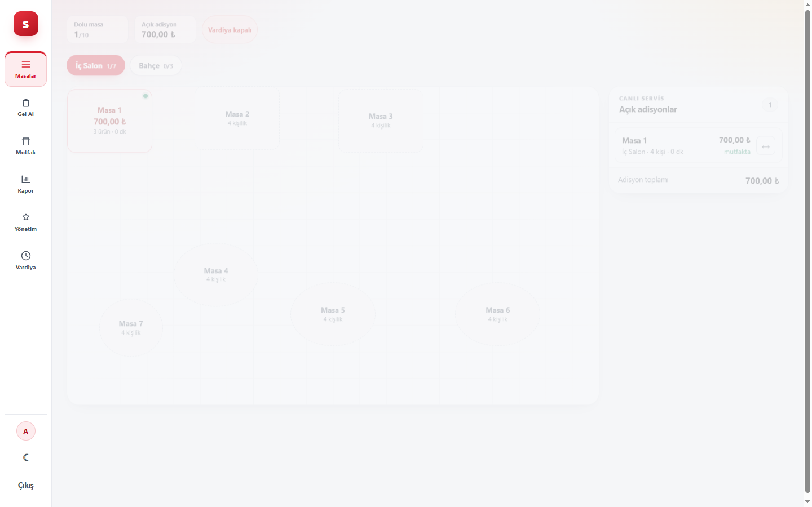
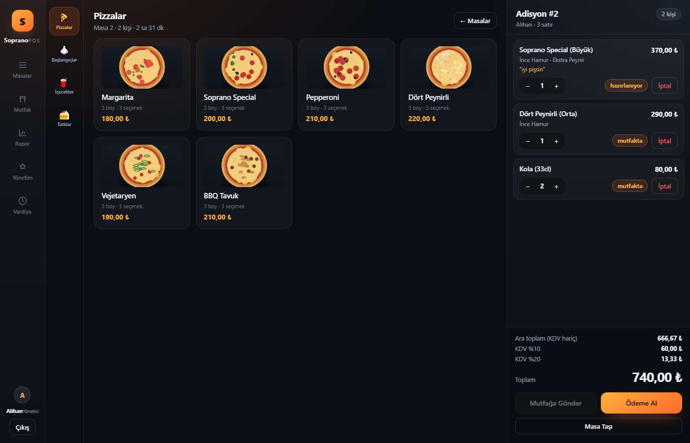
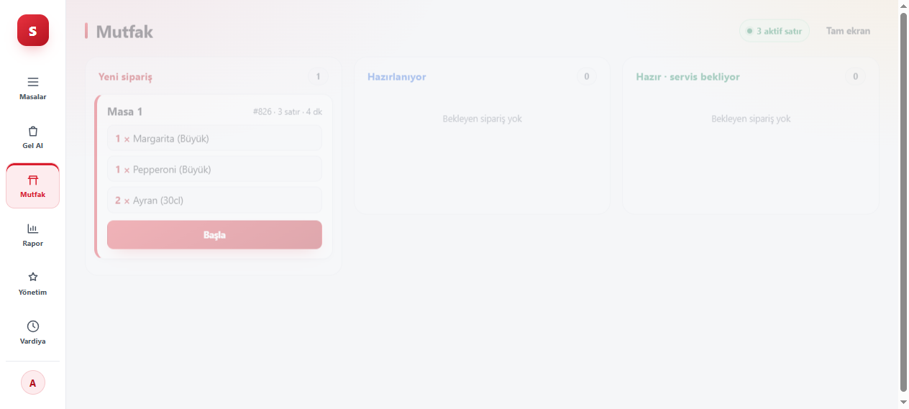
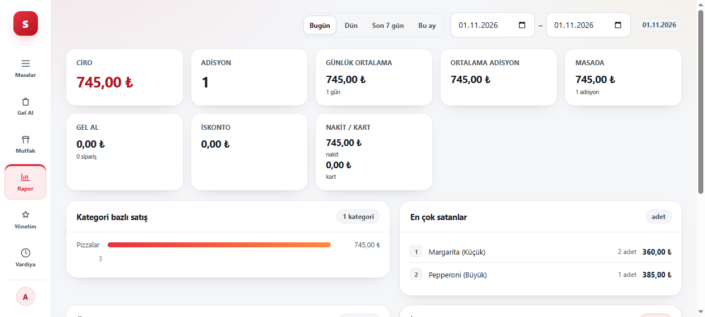
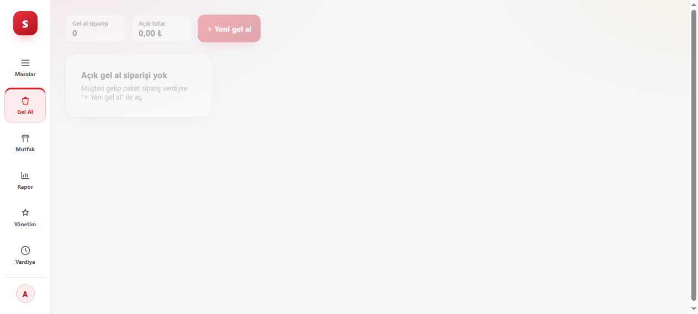
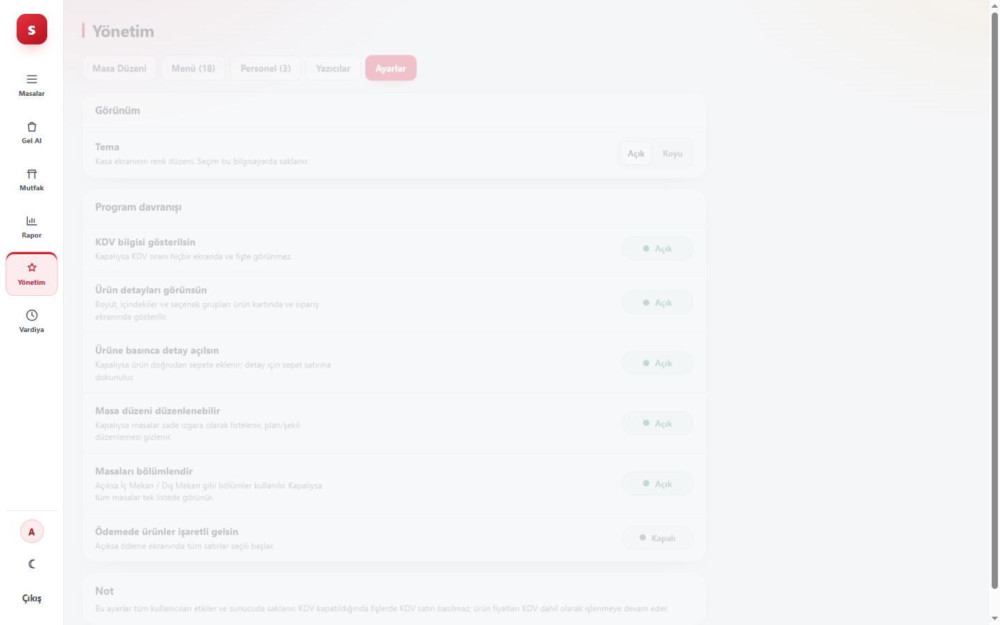

<p align="center">
  
</p>

<h1 align="center">Soprano POS</h1>

<p align="center">
  Pizzacı ve restoranlar için <b>tek sunucuda</b> çalışan dokunmatik satış noktası.<br>
  Masa, adisyon, mutfak ekranı, gel al, yazıcı ve raporlar — tablet tarayıcıda.
</p>

<p align="center">
  
  
  
  
  
  
  
</p>

---

## Neden Soprano?

- **İnternet gerekmez.** Sunucu dükkândaki bilgisayarda; tabletler aynı ağdan bağlanır. Bağlantı kopsa da adisyon açılır.
- **Tablet yeter.** Uygulama kurmadan tarayıcıdan açılır, ana ekrana eklenebilir (PWA).
- **Tek klasör yedek.** Tüm veri `var/` altında: veritabanı, ürün görselleri, fişler.
- **MIT lisans.** Kendi işletmenize kurabilir, değiştirebilir, başka şubelere uyarlayabilirsiniz.
- **Gerçek restoran akışı.** Parçalı ödeme, iskonto, satır iptali, iptal gerekçesi, vardiya, mutfak fişi.

## Ekranlar

| Masalar | Adisyon |
|---|---|
|  |  |

| Mutfak (KDS) | Raporlar |
|---|---|
|  |  |

| Gel Al | Ayarlar |
|---|---|
|  |  |

## Özellikler

**Salon**
- Masa planı: kare / yuvarlak / dikdörtgen, sürükle-bırak yerleşim, kat-bölüm (İç Salon, Bahçe…)
- Bölümleri kapatma seçeneği: tek ekranda kutu kutu masa listesi
- Masaya ilk dokunuşta **kaç kişi?** penceresi
- Açık adisyon rayı, masa taşıma

**Sipariş**
- Boyut, içindekiler (çıkar/ekle), seçenek grupları (sos, pişirme…), satır notu
- Ürün detaylarını gizleme: tek dokunuşla sepete ekleme, notu sepetten yazma
- Kategoriler üst şeritte, kategori görselleri yüklenebilir
- Ürün aktif/pasif: malzeme bitince menüden düşer, yönetimde kalır
- Mutfağa gönderim + animasyonlu onay

**Ödeme ve kasa**
- Satır bazlı / parçalı ödeme, canlı para üstü
- İskonto (% veya ₺), nakit/kart, müşteri adı
- Adisyon ve satır iptali: gerekçe + personel kaydı, raporda ayrı panel
- Vardiya aç/kapa, kasa özeti

**Mutfak**
- Yeni → Hazırlanıyor → Hazır akışı, canlı güncelleme (SSE)
- Aynı adisyon tek kartta, satır bazlı durum

**Yazıcılar**
- Mutfak **KOT**, kasa **fişi** ve **iptal fişi**
- Ağ (9100), USB (Windows spooler) veya dosya (test)
- Test fişi, iş kuyruğu, hata durumunda tekrar dene

**Raporlar**
- Tarih aralığı (Bugün / Dün / Son 7 gün / Bu ay veya serbest)
- Ciro, adisyon sayısı, günlük ortalama, ortalama adisyon
- Masada / Gel Al ayrımı, kategori bazlı satış, en çok satanlar
- Nakit/kart dağılımı, iskonto toplamı, ödenen ve iptal edilen adisyonlar

**Gel Al**
- Masadan bağımsız paket siparişleri, müşteri adı ve telefon
- Ayrı ekran ve ayrı rapor kalemi

**Masa işlemleri**
- Dolu masada `⋯`: öde, hızlı öde, iptal, ön hesap yazdır, masa değiştir, birleştir, adisyon aktar

**Cari (veresiye)**
- Müşteri kartı: ad, telefon, not, kredi limiti
- Adisyonu tek tuşla **cariye yaz**, bakiye ve hareket geçmişi
- Tahsilat (nakit/kart), kısmi ödeme, manuel düzeltme
- Aylık cari satış / tahsilat özeti, borçlu listesi, WhatsApp hatırlatma

## Hızlı başlangıç

### Windows (kurulum paketi)

1. [Node.js LTS](https://nodejs.org) kurun
2. Projeyi `C:\Soprano` gibi bir klasöre çıkarın
3. `Kur.bat` → `Soprano POS.bat`
4. Tarayıcıda `http://localhost:8095`

Yazıcı köprüsü ayrı pencerede: `Soprano-Yazici.bat`.

### Kaynaktan

```bash
npm install
npm run seed      # menü, masalar, personel (idempotent)
npm run build
npm start         # http://localhost:8095
```

Geliştirme: `npm run dev` (API 8095 + Vite 5175).

### Demo PIN'leri

| Kişi | Rol | PIN |
|---|---|---|
| Alihan | Yönetici | `1234` |
| Deniz | Garson | `1111` |
| Ece | Kasiyer | `2222` |

> Sahaya çıkmadan önce personeli yönetim ekranından yenileyin; demo PIN'lerini kullanmayın.

## Yönetim

| Sekme | İş |
|---|---|
| Menü | Ürün ekle/düzenle, fiyat, boyut, içindekiler, seçenek grubu, görsel, aktif/pasif |
| Kategoriler | Kategori görseli yükle |
| Personel | Kullanıcı, rol, PIN |
| Masa Düzeni | Masa ekle, şekil/boyut, yerleşim |
| Yazıcılar | Mutfak/kasa yazıcısı, test fişi, kuyruk |
| Ayarlar | KDV görünümü, ürün/sipariş detayı, masa bölümleri, masa düzeni, ödeme seçimi, tema |

## Yazıcı mimarisi

Tarayıcı yazıcıya doğrudan erişemez. Akış:

```
Tablet (tarayıcı)
   │  HTTP
   ▼
Sunucu (Fastify)  ──►  print_jobs kuyruğu
                          │  2 sn'de bir GET /api/print/jobs
                          ▼
                 Köprü (kasadaki laptop)  ──►  Mutfak (ağ 9100)
                                            └►  Kasa (USB spooler)
```

- Yazıcı tanımlı değilse iş kuyruğa girmez (yanlış yazıcıya fiş gitmez).
- 80 mm → 42, 58 mm → 32 karakter.
- `BRIDGE_TOKEN` verilirse köprü istekleri `x-bridge-token` ister.

## Mimari

```
src/server   Fastify API, para matematiği, fiş kuyruğu, PGlite
src/bridge   ESC/POS köprüsü (ayrı süreç)
src/ui       React 19 + Vite PWA (POS, KDS, rapor, yönetim)
```

- **Veritabanı:** PGlite (gömülü Postgres) → `var/pgdata`, şema birebir Postgres.
- **Para:** kuruş cinsinden integer; KDV dahil fiyat, satır bazlı dağıtım.
- **Yetki:** garson / kasiyer / yönetici, sunucuda uygulanır.
- **Canlılık:** SSE + yedek yenileme.

## Test

```bash
npm test          # 36 birim testi (para, KDV, iskonto, ödeme dağıtımı, fiş)
npm run typecheck # tsc --noEmit
```

Uçtan uca betikler: `scripts/e2e.py`, `e2e_payments.py`, `e2e_layout.py`, `e2e_products.py`, `e2e_printers.py`, `e2e_cancel_print.py`.

## Güncelleme

Kurulum git ile alındıysa:

```bash
git pull
npm install
npm run build
```

Windows'ta **GUNCELLE.bat** bunu yapar: sunucuyu kapatır, güncellemeyi çeker, derler ve yeniden başlatır. `var/` klasörüne dokunmaz.

## Yapılandırma

| Değişken | Varsayılan | Açıklama |
|---|---|---|
| `PORT` | `8095` | API ve arayüz portu |
| `SOPRANO_DB` | `var/pgdata` | Veri klasörü |
| `SOPRANO_API` | `http://127.0.0.1:8095` | Köprünün bağlanacağı sunucu |
| `BRIDGE_TOKEN` | — | Köprü istekleri için paylaşılan anahtar |
| `DRY_RUN` | yazıcı yoksa `1` | Fişi dosyaya yazar (`var/prints`) |

## Yol haritası

- [ ] Kurye takibi ve teslimat durumu
- [ ] QR menü
- [ ] ÖKC / e-Arşiv entegrasyonu
- [ ] Mikro ERP aktarımı
- [ ] Stok ve reçete düşümü
- [ ] Masa birleştirme

## Katkı

Issue ve PR açabilirsiniz. Büyük değişiklikler için önce bir issue'da konuşalım.

## TeqStudio

<p align="center">
  <br>
  <b>developed by TeqStudio</b><br>
  <sub>Dünya açık kaynak kodu destekleyen geliştiriciler sayesinde dönüyor.<br>Bizim de dönmesinde katkımız olsun.</sub><br><br>
  <sub>© 2026 TeqStudio</sub>
</p>

## Sürüm geçmişi

Ayrıntılar: [CHANGELOG.md](CHANGELOG.md) — son sürüm **v0.2.1**.

## Lisans

[MIT](LICENSE) — ticari kullanım dahil serbesttir. Garanti verilmez.
